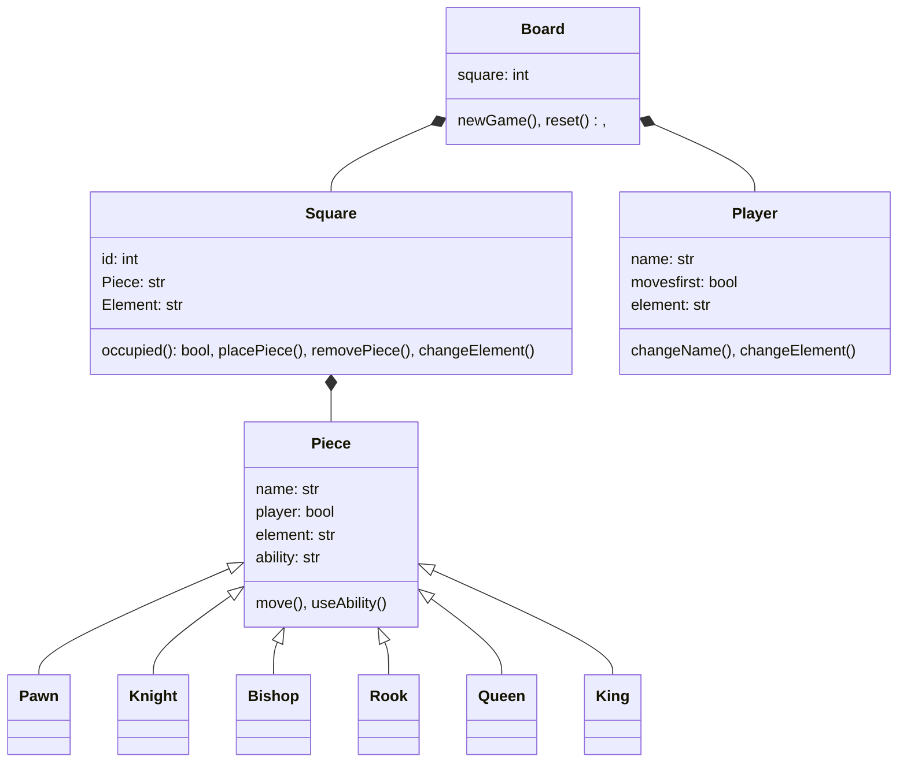

# Elemental Chess
1) Project Name: Elemental Chess

   Team Name: Team Elements

   Team Member(s): Vijay Kodali

   I am trying to build a turn-based strategy game inspired by chess where the player can choose an element which gives pieces unique abilities. It will be a fun    new game for strategy gamers to enjoy. I want to build this project to challenge myself to learn some elements of game design while also practicing all of the    fundamentals of object-oriented programming and graphical representation.

2)

3) Team Member: Vijay Kodali

   Game Design: 10 hours

   Board Representation w/ Static Pieces: 2 hours

   Player Names and Choosing an Element: 2 hours

   Piece Movement: 5 hours

   Piece Abilities: 10 hours

   New Game Functionality: 2 hours

   Since I am doing this project alone, all work will be done by me. The main problem area I can see is piece abilities. Depending on the complexity of the interactions, this could take a lot of time since abilities could interact with different elements in unique ways. I will need to be mindful of the scope when designing the abilities. Additionally, piece movement could take longer than anticipated since the user needs to have an indication of all legal moves when clicking a piece. Also, game design may be difficult to accurately estimate since it will not all take place at the beginning. Initial game design may have to be changed periodically as complications arise during development or gameplay testing.

**November 2nd Project Course Project Progress Report**
___
1)

The 8x8 board displays at the left. The board was implemented using a GridPane, and each cell in the grid was set to alternating colors between a light-square beige and dark-square green. Once implemented, pieces will display on the top two and bottom two rows, and the color of the pieces will reflect the chosen elements. Certain piece abilities may change the color of certain squares on the board, so there will need to be both a light-square and dark-square version of each elemental color included in the game. When the user clicks the "New Game" button at the right, the board and pieces will reset to its initial state, and each player will have the opportunity to choose their element for the next game. Once elements are selected, pieces will appear with the corresponding color selected by the player. Players will alternate moves until a game result is achieved. Once complete, the result will display on the screen until the user starts a new game.

2) See below.

3) Checkpoint Plan

   -Implement functionality of "New Game" button. When button is clicked, Player 1 should be prompted to choose a name and element. A confirm button should display for the user to click when complete. To complete by 11/5.
   
   -Implement functionality of "Confirm" button. When button is clicked, Player 2 should be prompted to choose a name and element. The confirm button should continue to display. To complete by 11/7.
   
   -Implement functionality of 2nd "Confirm" button click. When the button is clicked, the chosen names of each player should display below and above the board respectively with the element name in parentheses. The pieces will also display. To complete by 11/10.
   
   -Implement functionality of moving each piece. A player will move a piece by clicking and dragging the piece to the new square. The move will complete on release of the mouse button. To complete by 11/16.
   
   -Implement the logic of abilities for each piece. When a player right-clicks on a piece the ability will activate. To complete by 11/28.
   
   -Implement the game resolution logic. When the game completes, the result will display on the screen. To complete by 11/29.

5) Challenges and Solutions

   |Challenge|Solution|
   |---|---|
   |Board Representation|I was able to implement the board with GridPane and some nested for loops. Added the piece representations is a bit more challenging because the pieces must be colored to match the element the player selected. This will take some time to troubleshoot, but it should not take more than a couple hours to complete.|
   |Game Design|Initial game design took quite a bit of time. I decided to narrow the number of elements to four to limit complexity of interactions while still providing unique and interesting gameplay. A lot of this work is done, but there will be additional work when testing the gameplay to ensure the game mechanics are consistent, interesting, and thematically relevant to the element. Finishing the implementation as quickly as possible to provide the maximum time for testing game mechanics will dictate how successful this project is.|
   |Moving Pieces and Using Abilities|Implementation of these features will take a significant amount of time because there are six unique pieces for each of four elements. Each has unique mechanics, so it will be the majority of the remaining time I have. It doesn't seem conceptually challenging, but the implementation and testing will be time-consuming and I need to stay diligently on schedule.|
   |Game Resolution|This isn't that complicated to implement, but it will be important to consider during play-testing. The conditions for winning a game need to feel satisfying and skillful.|
